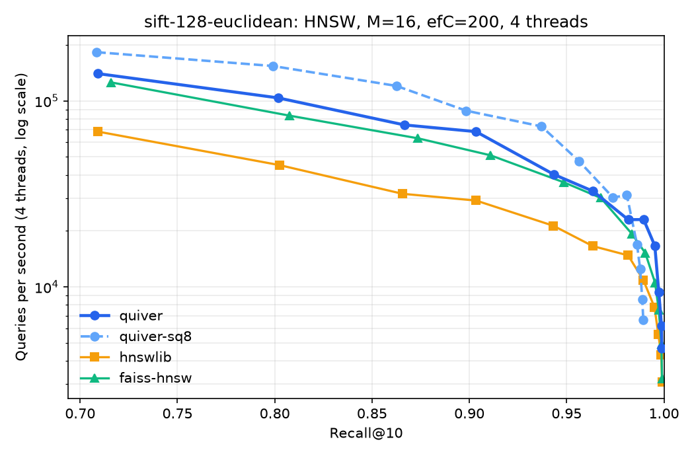
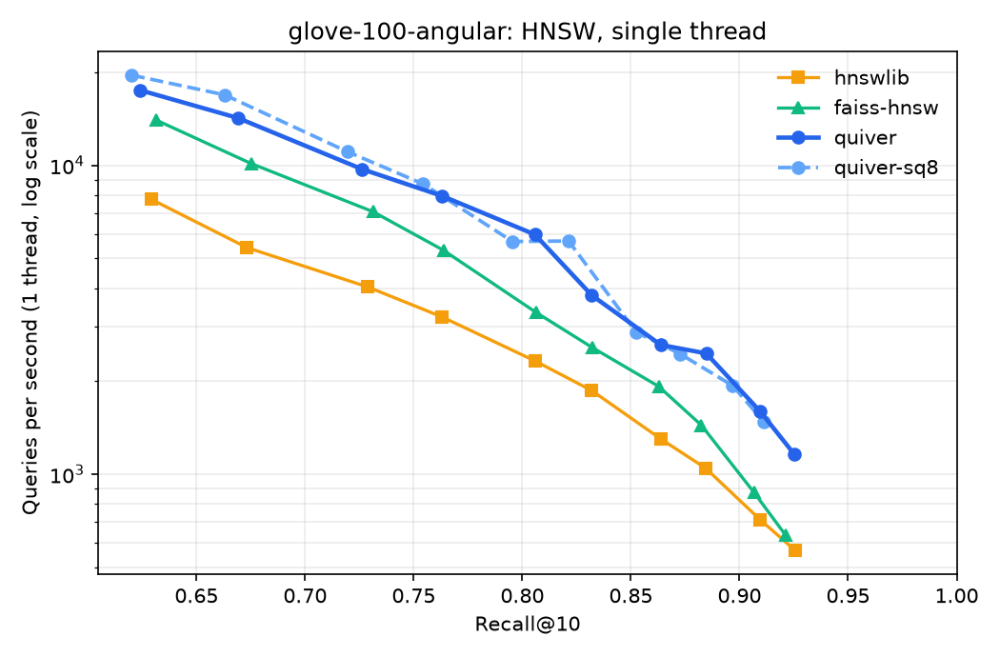
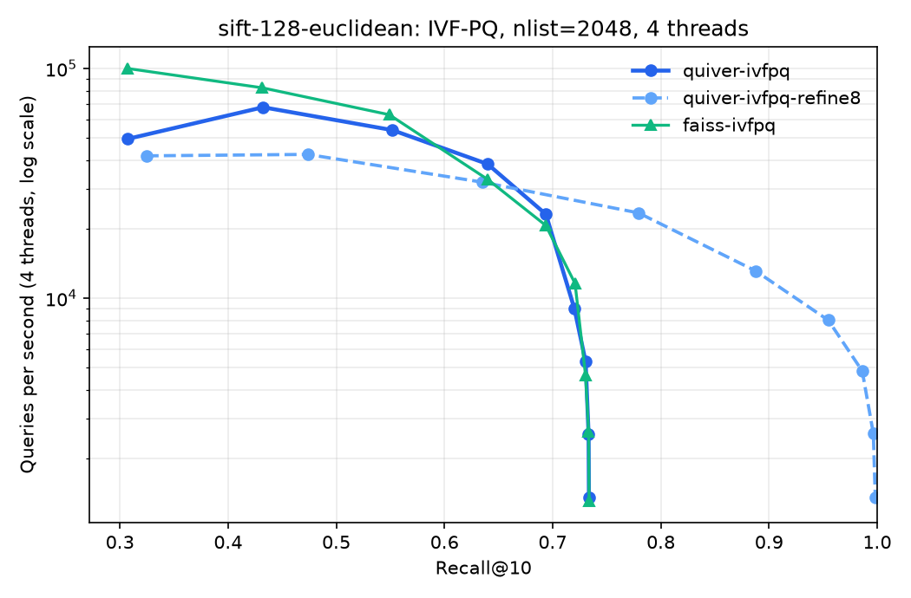

# Quiver

[](https://github.com/TheWiseGhost/quiver/actions/workflows/ci.yml)

**A vector search engine written from scratch in C++20**: HNSW and IVF-PQ indexes,
hand-written NEON/AVX2 SIMD kernels, lock-free concurrent search, zero-copy `mmap` persistence,
and Python bindings.

```python
import numpy as np, quiver

index = quiver.HnswIndex(dim=768, metric="cosine", M=16, ef_construction=200)
index.add(embeddings)                                   # parallel insert, GIL released
labels, distances = index.search(queries, k=10, ef=64)  # batched, multithreaded
labels, _ = index.search(q, k=10, filter=allowed_ids)   # filtered (pre-filter) search
index.save("docs.qvr")
index = quiver.HnswIndex.load("docs.qvr", mmap=True)    # O(metadata) load, still mutable
```

## Highlights

- **Beats hnswlib and FAISS on standard benchmarks.** On SIFT1M and GloVe-1.2M
  (ann-benchmarks), with identical parameters and threads, Quiver's HNSW serves 1.5–1.7×
  FAISS-HNSW's and 2.0–2.5× hnswlib's queries per second at equal recall (single-threaded), and
  builds the index 1.3–1.9× faster than both. [Results below](#benchmarks).
- **SIMD kernels with runtime dispatch.** Scalar, ARM NEON and x86 AVX2+FMA implementations of
  L2, inner product and 8-bit-quantized distances, selected by CPUID at startup. NEON is 5×
  faster than scalar. On ARM the kernels are inlined straight into the graph-search loop.
- **Lock-free concurrent search.** `search`, `add` and `remove` can run simultaneously from any
  number of threads. Graph edges are published with release/acquire atomics, storage grows in
  chunks that never move, and writers never hold more than one lock. Verified with
  ThreadSanitizer.
- **Three index types.** HNSW (float32 or SQ8, 4× smaller), IVF-PQ with residual product
  quantization (~16–32 bytes per vector), and an exact flat index. All support metadata
  filtering, with an automatic exact-scan fallback for very selective filters.
- **Production-grade persistence.** A checksummed (hardware CRC32C) section format and crash-safe
  atomic saves. Zero-copy copy-on-write `mmap` loading keeps the index mutable without ever
  writing to the file. A structural validator makes even maliciously crafted files memory-safe
  (fuzzed with libFuzzer).
- **Tested hard.** 75 C++ tests and 41 Python tests run clean under AddressSanitizer,
  UndefinedBehaviorSanitizer and ThreadSanitizer, build warning-free under GCC and Clang with
  `-Wconversion -Werror`, and forced through every SIMD code path
  (AVX2 tested via Rosetta 2 on Apple Silicon). CI covers GCC/Clang on Linux x86 and ARM plus
  macOS.
- **Plugs into [RecallKit](https://github.com/TheWiseGhost/recall)** as a drop-in `VectorIndex`
  backend ([integrations/recallkit](integrations/recallkit)).

## Benchmarks

[ann-benchmarks](https://github.com/erikbern/ann-benchmarks) datasets with their exact ground
truth (10,000 queries, recall@10). All libraries use the same `M=16`, `efConstruction=200`, the
same `ef` sweep and the same threads (the 4 performance cores of an Apple M5), best of 3 runs,
measured back to back with the library order rotated between datasets. Versions: hnswlib 0.8,
FAISS 1.15 (`IndexHNSWFlat`, `IndexIVFPQ`). Raw results are in [`results/`](results), and
`tools/run_benchmarks.sh` reproduces everything.

### SIFT1M (1M × 128, L2)



| | build | QPS @ 0.964 recall | QPS @ 0.990 recall | 1-thread QPS @ 0.990 | memory |
|---|---:|---:|---:|---:|---:|
| **Quiver** | **86 s** | **32.7k** | **23.0k** | **4.6k** | 649 MB |
| **Quiver SQ8** | **76 s** | **47.3k** (0.956) | n/a (tops out at 0.989) | n/a | **264 MB** |
| FAISS-HNSW | 113 s | 30.1k | 15.2k | 2.8k | |
| hnswlib | 143 s | 16.6k | 10.9k | 1.8k | |

### GloVe-1.2M (1,183,514 × 100, angular)



| | build | QPS @ 0.763 recall | QPS @ 0.885 recall | 1-thread QPS @ 0.763 | 1-thread QPS @ 0.885 |
|---|---:|---:|---:|---:|---:|
| **Quiver** | **118 s** | **32.8k** | **8.7k** | **8.0k** | **2.5k** |
| FAISS-HNSW | 155 s | 21.4k | 7.3k | 5.3k | 1.4k |
| hnswlib | 228 s | 17.5k | 5.8k | 3.2k | 1.0k |

At the very top of the curve (recall ≈ 0.92, `ef=512`) multithreaded throughput is a tie
(Quiver 3.1k, hnswlib 3.2k, FAISS 3.3k at 0.921). Single-threaded, Quiver still leads there: 1.16k QPS vs 0.63k (FAISS) and 0.57k (hnswlib).
More plots: [SIFT single-thread](docs/img/sift-128-euclidean-hnsw-1thread.png),
[GloVe 4 threads](docs/img/glove-100-angular-hnsw.png).

### IVF-PQ vs FAISS (`nlist=2048`; SIFT m=32, GloVe m=25)



Quiver's IVF-PQ is the same algorithm as FAISS's `IndexIVFPQ` and reaches **identical recall**
at every `nprobe` (e.g. SIFT: 0.640 at nprobe=8, 0.721 at 32). Throughput is on par: FAISS is
faster at nprobe ≤ 4, Quiver at nprobe 8–16 (SIFT nprobe=8: 38.4k vs 32.9k QPS). FAISS trains
about 30% faster (21 s vs 30 s). Quiver's optional exact re-ranking (`refine_factor=8`) lifts
SIFT recall from a PQ ceiling of 0.73 to **0.986 at nprobe=64** (4.8k QPS). Index memory without
re-ranking is 108 MB, against 512 MB for the raw vectors.

### Distance kernels

Single call, both operands in L1:

| kernel, d=128 | scalar | NEON | speedup |
|---|---:|---:|---:|
| L2² | 4.7 GFLOP/s | 24.2 GFLOP/s | 5.2× |
| dot | 4.9 GFLOP/s | 25.5 GFLOP/s | 5.2× |
| SQ8 L2² | 2.6 Gdim/s | 5.8 Gdim/s | 2.3× |

The machine had moderate background load during these runs, so absolute numbers are
conservative. Relative comparisons are fair: every library ran under the same conditions.

## How it works

The full write-up, including the concurrency argument and a log of every optimization that did
or didn't pay off, is in **[docs/DESIGN.md](docs/DESIGN.md)**. In short:

```
python/quiver (nanobind)          integrations/recallkit (async VectorIndex adapter)
include/quiver/  HnswIndex · IvfPqIndex · FlatIndex · ScalarQuantizer · ProductQuantizer
src/internal/    ChunkedStorage · CentroidTable (GEMM-style microkernel) · file format · CRC32C
src/simd/        scalar / NEON / AVX2+FMA kernels + runtime dispatch
```

- **HNSW insert** runs in two phases: wire the new node's own adjacency on every layer, *then*
  publish reverse edges. A search can therefore never land on a half-built node. Getting this
  wrong (found by a stress test) caused short result lists and 6× more unreachable nodes in
  parallel builds.
- **Search** gathers each expanded node's unvisited neighbors and prefetches all of their vectors
  before computing any distance, so cache misses overlap (≈ 20% lower latency at 1M vectors).
  Visited sets use epoch tags, which makes clearing O(1), and all scratch memory is thread-local,
  so the hot path never allocates.
- **k-means and PQ** use a transposed centroid table and a register-blocked 4 × 16 microkernel
  built from portable vector types. Encoding got 4.5× faster and k-means 1.6× faster.
- **IVF-PQ L2 search** uses the precomputed decomposition
  `‖q−c−r‖² = ‖q−c‖² + (‖r‖² + 2⟨c,r⟩) − 2⟨q,r⟩`, so probing a cell costs `m × 256` additions.

## Building

Requires CMake ≥ 3.20 and GCC ≥ 11 or Clang ≥ 14 (Linux or macOS).

```bash
cmake --preset release && cmake --build --preset release
```

```bash
ctest --preset release
```

```bash
cmake --preset asan && cmake --build --preset asan && ctest --preset asan
```

```bash
cmake --preset tsan && cmake --build --preset tsan && ctest --preset tsan
```

```bash
QUIVER_SIMD=scalar ./build/release/tests/quiver_tests
```

Python package (builds the C++ core with scikit-build-core and nanobind):

```bash
pip install .
```

Benchmarks:

```bash
./build/release/bench/ann_bench --synthetic 100000,128,1000 --index hnsw --ef 16,32,64,128
```

```bash
./build/release/bench/bench_kernels
```

```bash
tools/run_benchmarks.sh
```

## Using it from C++

```cpp
#include <quiver/hnsw_index.h>

quiver::HnswParams p;
p.dim = 128;
p.metric = quiver::Metric::kL2;
quiver::HnswIndex index(p);
index.add(data, n);                                        // labels 0..n-1, parallel insert

quiver::HnswSearchParams sp;
sp.ef = 64;
std::vector<quiver::Neighbor> hits = index.search(query, 10, sp);

quiver::BitsetFilter allowed(n);                           // filtered search
allowed.insert(42);
sp.filter = &allowed;
hits = index.search(query, 10, sp);

index.save("index.qvr");
auto mapped = quiver::HnswIndex::load("index.qvr", {.mmap = true});
```

Link with `find_package(quiver)` / `quiver::quiver`, or `add_subdirectory`.

## Layout

| Path | Contents |
|---|---|
| `include/quiver/` | public API |
| `src/` | indexes, quantizers, thread pool; `src/simd/` kernels; `src/internal/` storage and file format |
| `tests/` | GoogleTest suites, including concurrency, corruption and code-review regression tests |
| `bench/` | `bench_kernels` (Google Benchmark), `ann_bench` (recall/QPS/latency harness) |
| `fuzz/` | libFuzzer target for the index loader, plus seed-corpus generator |
| `python/` | nanobind extension, Python API, pytest suite |
| `integrations/recallkit/` | RecallKit `VectorIndex` adapter and tests |
| `tools/` | dataset download, cross-library comparison, plotting |
| `docs/DESIGN.md` | design notes and experiment log |

## License

MIT
